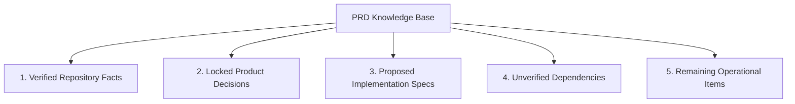
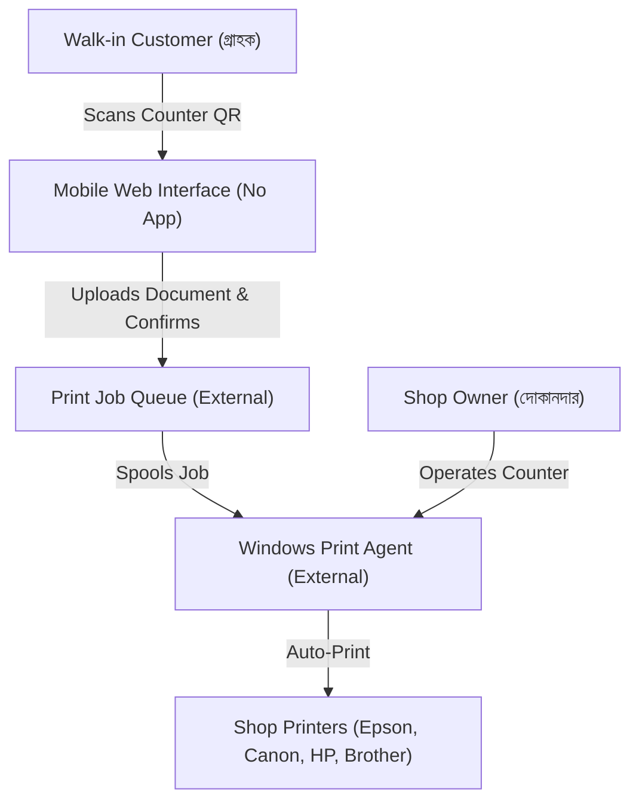
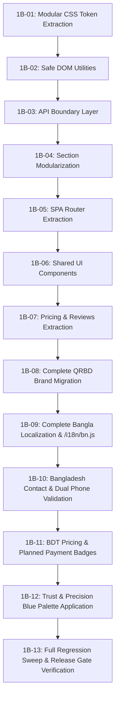

# QRBD — Product Requirements Document (PRD)

## Document Status
- **Status:** Locked Draft for Product Owner Final Approval
- **Version:** 1.2.0 (Phase 1 MVP — Locked Decisions Baseline)
- **Date:** 2026-10-21
- **Product Owner:** QRBD Leadership Team
- **Implementation Lead:** Antigravity AI (Pair Programming Senior Architect & Lead Engineer)
- **Target Release:** Phase 1 Marketing Landing Page (`qrbd.digiseba.shop`)
- **Workspace File:** [`docs/PRD.md`](file:///c:/Users/livem/Downloads/Compressed/QRBD/docs/PRD.md)

---

## 1. Product Overview

**QRBD** is an automated, privacy-first, cloud-to-local printing software solution designed specifically for photocopy shops, cyber cafés, stationery stores, universities, and digital service centers (ডিজিটাল সেবা কেন্দ্র / ইউনিয়ন ডিজিটাল সেন্টার) across Bangladesh.

The system transforms the walk-in printing experience:
1. Walk-in customers scan a unique shop QR code displayed at the counter using any smartphone camera or browser—**with zero mobile application installation required**.
2. Customers upload documents (PDFs, images, government forms, photo sheets) directly through a lightweight mobile web interface, configure basic print parameters (copies, color/B&W), and preview their files.
3. Payment options are handled according to shop setup: counter cash payment or planned Mobile Financial Services (MFS).
4. The document is dispatched to the print queue for automatic output on the shop's local Windows PC and connected printers.
5. Uploaded customer files are treated as temporary working data and deleted automatically following print processing.

> [!IMPORTANT]
> **Integration & Readiness Boundaries:**
> 1. **Windows Print Agent & Backend:** The Windows Print Agent and backend queue systems are existing dependencies or future integration surfaces. **Their production readiness is not verified by this PRD and is strictly outside Phase 1 marketing landing-page scope.**
> 2. **Payment Integrations:** Displaying local payment badges (bKash, Nagad, Rocket, Upay) communicates planned/supported options. **Live payment gateway transactions are not active in Phase 1.** Badges must not falsely claim live checkout availability until backend integrations are implemented and verified.
> 3. **Temporary Deletion:** The landing page communicates temporary file deletion only to the extent supported by actual backend implementation. No numeric deletion promises (e.g. "120 seconds") will be published until verified by backend evidence.

---

## 2. Evidence, Decisions, and Assumptions

All requirements and statements in this PRD are classified into five explicit evidentiary tiers:

### A. Verified Repository Facts
- The codebase is a zero-build Vanilla JavaScript application ([`index.html`](file:///c:/Users/livem/Downloads/Compressed/QRBD/index.html), [`i18n.js`](file:///c:/Users/livem/Downloads/Compressed/QRBD/i18n.js), [`i18n-extra.js`](file:///c:/Users/livem/Downloads/Compressed/QRBD/i18n-extra.js)).
- The repository was initialized at Git baseline commit [`4535a13`](file:///c:/Users/livem/Downloads/Compressed/QRBD) and synchronized to production baseline [`4803726`](file:///c:/Users/livem/Downloads/Compressed/QRBD).
- The working tree currently holds an uncommitted Phase 1A-05 security patch on `index.html` (SEC-01 review escaping, SEC-02 safe credential copying via `data-copy`, SEC-03 safe logo URL protocol validation).
- Root `index.html` contains 289 legacy references to `legacy brand`, 81 references to `legacy-domain`, 7 references to Indian WhatsApp numbers (`8404832414`), and 3 references to `legacy-support@gmail.com`.
- Root does not currently host `/i18n/bn.js` statically, causing the language switcher in the current draft to fall back silently to English upon selecting `বাংলা`.
- 10 inline script blocks pass `node --check` syntax validation; 6 JSON-LD schemas parse valid JSON; all local asset 404s have been resolved.

### B. Locked Product Decisions (Product Owner Approved)
- **Public Brand Name:** `QRBD`.
- **Target Production Domain:** `qrbd.digiseba.shop`.
- **Official Support Email:** `hello@digiseba.shop`.
- **Official Support Phone / WhatsApp:** `+8801824741444`.
- **Pricing Currency:** Bangladeshi Taka (BDT / `৳`). Placeholder or "price to be confirmed" notices will be used until exact pricing figures are signed off. No unapproved prices will be published.
- **Payment Badges:** Display planned local payment badges (**bKash**, **Nagad**, **Rocket**, **Upay**) with clear labeling as supported/planned payment options (no false live-transaction claims).
- **Dual Bangladesh Phone Formats:** Support both local format (`01XXXXXXXXX`, 11 digits) and international format (`+8801XXXXXXXXX`, 14 characters) with safe internal normalization and bilingual validation messages.
- **WhatsApp-to-Print Feature:** Retained in information architecture as an **"Upcoming Capability"** (secondary/future scope; not marketed as operational in Phase 1).
- **Language Selector:** Mandatory first-class support for **English** and **Bangla**. Existing technical languages (`ta`, `te`, `kn`, `hin`) remain in underlying dictionaries without removal, but must not confuse the primary Bangladesh audience.
- **Bangla Release Gate:** Full Bangla localization is a **strict mandatory release requirement** before Phase 1 launch.
- **Canary Guard:** Unchanged during development; migration to `qrbd.digiseba.shop` scheduled for final production deployment after full QA.
- **Visual Palette:** "Trust & Precision Blue" (`#0f4c81` Navy, `#00b4d8` Cyan, `#f59e0b` Amber, `#f8fafc` Canvas, `#ffffff` Card).

### C. Proposed Implementation Specs
- Comprehensive bilingual translation coverage for all 842 visible landing-page text nodes and future additions.
- Deploying static dictionary `/i18n/bn.js` in the actual root serving location to permanently resolve 404 and silent fallback issues.
- Clean responsive layout across 375px, 768px, 1024px, and 1440px viewports with 0px horizontal overflow.

### D. Unverified Dependencies
- **Windows Print Agent & Queue:** Desktop agent software and cloud processing queues are external dependencies. Their production readiness is not verified within this audit and is outside Phase 1.
- **Backend File Deletion Timing:** The exact timing and server-side deletion mechanics remain unverified. The landing page will communicate temporary file deletion in principle without publishing unverified numeric promises.

### E. Remaining Operational Items
- Final commercial subscription plan figures from business leadership.
- Final DNS cutover date for `qrbd.digiseba.shop`.

---

## 3. Problem Statement

Commercial computer and photocopy shops in Bangladesh handle customer print requests daily using broken, slow, and insecure manual workflows:

### A. The WhatsApp & Bluetooth Bottleneck
- Customers must save the shopkeeper's personal mobile number or scan a temporary WhatsApp QR code to send documents.
- Shopkeepers waste 3–5 minutes per customer opening WhatsApp Web, waiting for media to download, saving files to cluttered desktop folders, opening them in viewer applications, and configuring printer settings.
- Shop owners' personal WhatsApp inboxes become permanently clogged with customer chats, downloaded files, and off-hour customer inquiries.

### B. Privacy & Data Handling Risks
- Customers print sensitive personal documents: National ID cards (NID), academic certificates, birth records, passport scans, financial statements, and private photographs.
- Files downloaded via WhatsApp or left in desktop folders often remain accessible on shared computers, creating privacy concerns and identity theft exposure.

### C. Malware & Pendrive Contamination
- Walk-in customers bringing USB flash drives frequently introduce viruses, shortcut trojans, and ransomware to shop PCs, causing computer downtime and printer spooler corruption.

### D. Counter Queues & Customer Friction
- Long lines form during peak hours because manual file handling creates a physical bottleneck. Customers leave when queues are long, leading to lost shop revenue.

---

## 4. Product Vision

> [!NOTE]
> **Vision Clarification:** The following statement represents an aspirational, long-term business vision for the QRBD venture. **It is not a Phase 1 implementation requirement and is not a verified repository fact.**

**Long-Term Vision:** To become a trusted automated printing utility across Bangladesh, supporting digital print shops, photocopy centers, and digital service centers nationwide with instant, private, self-service mobile printing.

---

## 5. Target Users and Personas

### Persona 1: The Shop Owner / Cyber Café Proprietor (দোকানদার)
- **Profile:** Runs a commercial photocopy, stationery, or computer service shop in an urban or semi-urban market in Bangladesh. Operates 1–3 Windows PCs and multiple printers.
- **Core Needs:** Faster counter turnover, zero USB virus downtime, elimination of WhatsApp clutter, transparent local subscription pricing in BDT (`৳`), automated print output.
- **Pain Points:** Spends hours downloading files from WhatsApp, rotating upside-down photos, explaining print settings, dealing with infected PCs.

### Persona 2: The Front-Desk Counter Operator (কম্পিউটার অপারেটর)
- **Profile:** Employee managing the print desk during busy hours.
- **Core Needs:** Automated print queuing where files arrive directly at the correct printer with correct paper size and color settings.
- **Pain Points:** Stress during customer rushes, manual file cleanup, angry customers waiting in line.

### Persona 3: The Walk-in Customer (গ্রাহক)
- **Profile:** Student, job applicant, citizen printing official forms, or business professional.
- **Core Needs:** Quick printing from their smartphone without installing an app, no Bluetooth pairing, and assurance that personal documents are deleted after printing.
- **Pain Points:** Reluctance to share personal phone numbers or send private files to a stranger's WhatsApp; waiting in long queues.

### Persona 4: The Commercial Partner / Distributor (ব্যবসায়িক অংশীদার)
- **Profile:** Hardware vendor or IT entrepreneur looking to distribute QRBD software or offer managed print services across a district.
- **Core Needs:** Clear commercial terms, white-label options, responsive partner support from `hello@digiseba.shop`.

---

## 6. Product Goals

### User Goals
- Walk-in customers print documents from their mobile browser in under 60 seconds without app installation.
- User files are handled as temporary data and deleted following print completion.
- Shopkeepers eliminate manual WhatsApp file downloads, doubling counter capacity during rush hours.

### Business Goals
- Establish **QRBD** as a recognized digital print utility brand in Bangladesh.
- Acquire initial registered shop owners through free trial demo signups on the landing page.
- Convert trial users into paying subscribers once commercial tiers are launched.

### Phase 1 Goals (Current Milestone)
- Deliver a fast, rock-solid, production-ready marketing landing page at **`qrbd.digiseba.shop`**.
- Achieve verified bilingual support (**English** and **বাংলা**) meeting all release-gate criteria.
- Present transparent pricing in Bangladeshi Taka (**BDT / ৳**) with appropriate placeholder notices if figures remain unfinalized.
- Display planned payment badges (**bKash, Nagad, Rocket, Upay**) under strict truthfulness rules (clearly labeled as planned/supported options).
- Display the WhatsApp-to-print capability labeled as an **Upcoming Capability**.
- Apply the **Trust & Precision Blue** visual identity.
- Fix all pre-existing security weaknesses (SEC-01, SEC-02, SEC-03) and asset 404s while strictly maintaining zero-build Vanilla architecture.

---

## 7. Current Product Context & Repository Baseline

The current project is a refactor of an existing, zero-build Vanilla JavaScript application:
- **Baseline Git Commit:** [`4803726`](file:///c:/Users/livem/Downloads/Compressed/QRBD) (`chore: sync authoritative production landing baseline`).
- **Architecture:** Zero-build Vanilla JavaScript, modular inline CSS and script architecture, lightweight external runtime modules (`i18n.js`, `i18n-extra.js`).
- **Zero Framework Footprint:** Zero Node.js runtime build steps, zero Webpack/Vite/Tailwind overhead, zero React/Vue dependencies.
- **Authoritative Assets Present:** Production-ready `index.html` (restoring `work-67` festival discount banner and `work-69` all-inclusive tier), `icon-192.png`, `icon-512.png`, `apple-touch-icon.png`, `og-image.png`, `site.webmanifest`.
- **Existing Security State:** Phase 1A-05 security patch applied in working draft (SEC-01 reviews escaping, SEC-02 safe credential copying via `data-copy`, SEC-03 logo URL protocol validation).

---

## 8. Phase 1 MVP Scope

The Phase 1 MVP is strictly focused on the **public marketing landing page, informational SPA overlays, lead generation funnels, and localization engine**.

```mermaid
graph LR
    subgraph LandingPage["Phase 1 MVP Scope (qrbd.digiseba.shop)"]
        Nav["Header & Lang Switcher"]
        Hero["Hero Section & Value Prop"]
        Workflow["4-Step Visual Workflow"]
        Features["Feature Matrix & Video Guide"]
        Privacy["Temporary File Deletion Message"]
        Pricing["BDT Pricing & Plans Display"]
        Badges["Planned Payment Badges (bKash/Nagad)"]
        WhatsAppTeaser["WhatsApp Upcoming Capability"]
        Reviews["Verified Reviews Carousel"]
        FAQ["Native HTML5 Accordion"]
        Modals["Demo & Inquiry Modals (Dual Phone)"]
        Overlays["9 SPA Legal & Info Overlays"]
    end
```

### In-Scope Landing Page Components
1. **Header & Navigation:**
   - Sticky responsive header with brand mark (`QRBD`).
   - Language selector toggle (English / বাংলা as primary options; legacy dictionaries preserved safely).
   - Smooth-scrolling navigation anchors (`#pricingSection`, `#features`).
   - Shop Owner Login link (`/admin`).
   - Mobile hamburger navigation drawer (`#navBurger`, `#navDrop`).
2. **Hero Section:**
   - Value proposition headline in English and Bengali.
   - Dual primary call-to-action buttons: "Choose Plan ›" (smooth scroll) and "🎯 Register Demo" (opens instant demo modal).
   - Trust badges highlighting instant setup and privacy by design.
3. **Interactive 4-Step Customer Workflow:**
   - Visual step-by-step breakdown: **SCAN** (QR code) → **UPLOAD** (PDF/Image) → **PAY/CONFIRM** → **PRINT** (Instant auto-print).
4. **How-to-Setup Guide & Video Section:**
   - Quick-start guide outlining PC setup for shop owners.
   - Video player modal embed (YouTube-nocookie integration).
5. **Product Feature Showcase:**
   - Highlighting key capabilities: Smart Scanner integration, Automatic Duplex printing, 4×6 photo sheet auto-arrangement, A3 paper support, automatic NID card alignment.
6. **Privacy by Design Section:**
   - Clear explanation of temporary file handling and automated server/PC deletion.
   - *Truthfulness Constraint:* No specific numeric time claims (e.g. "120 seconds") will be published until verified against backend implementation.
7. **Pricing & Plans Section (BDT / ৳):**
   - 6 structured plan cards: Free Demo (24-hr trial), Monthly, Starter, Pro, Premium, Lifetime.
   - Currency presented in Bangladeshi Taka (BDT / `৳`). Clearly marked placeholder notices used if specific pricing figures are unfinalized.
   - Dynamic superadmin hydration via `/api/setup-fee/current` with static fallback pricing.
8. **Planned Payment Badges Section:**
   - Displaying local payment badges: **bKash**, **Nagad**, **Rocket**, **Upay**.
   - *Truthfulness Rule:* Clearly labeled as planned/supported payment options for Bangladesh without falsely implying live payment gateway checkout is currently active.
9. **WhatsApp-to-Print Teaser:**
   - Retained in section `#whatsappToPrint`, clearly badged as an **"Upcoming Capability"** for Bangladesh.
10. **Shopkeeper Reviews & Social Proof Carousel:**
    - Horizontal review card carousel with touch swipe, previous/next controls, star ratings, and safe 5-character entity escaping (SEC-01).
11. **Native FAQ Accordion:**
    - 17 comprehensive questions and answers built using native HTML5 `
` and `
` tags inside `#disclaimerPage`.
12. **24-Hour Instant Demo Registration Modal:**
    - Dual Bangladeshi phone format support (`01XXXXXXXXX` and `+8801XXXXXXXXX`).
    - Cloudflare Turnstile bot protection.
    - Dual result view: Instant auto-approval view (displaying Shop ID, temporary password, Windows agent download button, and QR poster download) or manual review view.
    - Safe credential copying using `data-copy` attributes (SEC-02).
13. **Business & Partner Inquiry Modal:**
    - Lead capture modal for distributor inquiries with direct dispatch to official WhatsApp (`+8801824741444`) and Email (`hello@digiseba.shop`).
14. **9 Client-Side SPA Informational Overlays:**
    - Seamless pushState URL routing without page reload for `/about`, `/features`, `/setup-guide`, `/contact`, `/partner`, `/terms`, `/privacy`, `/refund`, and `/disclaimer`. Cloned footer injection via `lgAddFooter()`.

---

## 9. Feature Classification

| Feature / System | Classification | Reason & Scope Boundary |
|---|---|---|
| **Marketing Landing Page & CTAs** | **KEEP** | Core Phase 1 deliverable. Must be polished, responsive, and localized. |
| **English & Bangla Localization** | **KEEP** | Mandatory release requirement. 100% UI coverage across both languages. |
| **BDT (`৳`) Currency Presentation** | **KEEP** | Locked decision. Prices presented in BDT with placeholder labels if unfinalized. |
| **Planned Payment Badges (bKash/Nagad)** | **KEEP** | Locked decision. Displayed with truthfulness labeling as planned payment options. |
| **Dual Bangladesh Phone Support** | **KEEP** | Locked decision. Supports `01...` and `+8801...` in demo/inquiry forms. |
| **WhatsApp-to-Print Teaser** | **KEEP** | Locked decision. Retained and clearly labeled as an "Upcoming Capability". |
| **9 SPA Informational Overlays** | **KEEP** | Essential for SEO, sitelinks, transparency, and legal compliance. |
| **Demo Modal & Inquiry Modal** | **KEEP** | Primary conversion funnels for lead acquisition. |
| **Pricing & Reviews Components** | **KEEP** | Essential social proof and commercial transparency. |
| **PWA Manifest & Metadata** | **KEEP** | Restored valid app manifest and Open Graph sharing previews. |
| **Public `/api/...` Endpoints** | **PRESERVE** | Existing API signatures must remain intact to support local staging replicas and backend compatibility. |
| **Canary Domain Guard** | **PRESERVE** | Anti-theft verification in `<head>` L4 remains active with existing allowlist until live production deployment. |
| **Internal Storage Keys** | **PRESERVE** | `qsp_visitor_id` and `qsp_site_lang` retained without blind renaming. |
| **Legacy Language Dictionaries** | **PRESERVE** | Dictionaries for `ta`, `te`, `kn`, `hin` preserved safely in files without confusing primary UI. |
| **CMS Dynamic HTML (`[data-cfg-html]`)** | **DEFER** | Superadmin rich text injection retained as-is; full DOMPurify hardening deferred to Phase 2. |
| **Dynamic FAQ Sanitization (SEC-04)** | **DEFER** | Retained existing `esc(f.q)` and `esc(f.a)` logic; complete DOM refactor deferred to Phase 1B. |
| **Indian Payment Logos (Cashfree, PayU, etc.)** | **REMOVE-LATER** | Replaced by planned Bangladesh payment badges (bKash, Nagad, Rocket, Upay). |
| **Legacy Customer Dialects (`mni`, `mni-mtei`)** | **REMOVE-LATER** | Excluded from landing selector; safely archived in Phase 2. |
| **Hardcoded Indian Phone Fallbacks** | **REMOVE-LATER** | To be cleanly updated to `+8801824741444` in Phase 1B. |

---

## 10. User Experience Requirements

1. **5-Second Value Clarity:**
   - Any visitor landing on `qrbd.digiseba.shop` must immediately understand: "Customers scan a QR code at the shop, upload from their phone, and the document prints automatically."
2. **Dual-Journey Visual Distinction:**
   - The landing page must clearly illustrate both perspectives:
     - **The Customer Experience:** Mobile browser, zero app install, upload, privacy-first temporary handling.
     - **The Shopkeeper Experience:** Windows PC, Print Agent runs in background, printers auto-feed, zero WhatsApp clutter.
3. **Loading, Empty, and Error States:**
   - **Loading States:** Forms must disable submission buttons and show loading spinners (`⏳ ডেমো তৈরি হচ্ছে...` / `⏳ Demo ban raha hai...`).
   - **Empty States:** The reviews section must remain completely hidden if `/api/reviews` returns an empty array.
   - **Fallback States:** If pricing API `/api/setup-fee/current` fails or is unreachable, the landing page must gracefully display the static HTML fallback pricing cards without breaking layout.
4. **Responsive Layout Fidelity:**
   - Supported viewport sweeps: **375px** (compact mobile), **768px** (tablet portrait), **1024px** (tablet landscape / laptop), and **1440px** (desktop).
   - Zero horizontal overflow (`scrollWidth === innerWidth`).
5. **Accessibility Standards:**
   - Minimum contrast ratio of 4.5:1 for body copy and 3:1 for large headers (WCAG AA).
   - Keyboard accessible navigation: Focus rings visible on Tab navigation, Escape key closes all open modals and overlays.

---

## 11. Full Bangla Support Requirement & Mandatory Release Gate

> [!IMPORTANT]
> **Bangla Release Gate:**
> Full Bangla localization is an **approved mandatory release requirement** before Phase 1 launch. The site must not be released with partial or broken Bangla support.

### Current Implementation Status vs. Release Target
- **Current Status:** Incomplete and not release-ready. Root lacks static hosting of `/i18n/bn.js`, causing 404 network errors and silent fallback to English upon selecting `বাংলা`. Furthermore, 131 visible landing text nodes in the baseline draft lack translations in the fixture.
- **Target Requirement:** 100% complete, verified bilingual support across all visible landing-page surfaces.

### Comprehensive Bangla UI Coverage Scope
Bangla must cover every visible, user-facing landing-page experience:
1. **Header:** Site brand label, top navigation links, shop login button.
2. **Navigation Drawer:** Mobile drawer menu items, icons, and action pills.
3. **Logo-Adjacent Labels:** Any subtext or status pills adjacent to the brand mark.
4. **Hero Section:** Main headline, secondary paragraph copy, primary CTA ("প্যাকেজ বেছে নিন"), secondary CTA ("🎯 ফ্রি ডেমো নিন"), trust badges.
5. **How-It-Works Workflow:** All step titles (স্ক্যান, আপলোড, পেমেন্ট/নিশ্চিতকরণ, প্রিন্ট) and detailed step explanations.
6. **Feature Matrix:** Smart Scanner, Automatic Duplex, Photo Print, A3 Support, NID Auto-align headings and descriptions.
7. **Setup Guide:** 2-minute quick-start guide steps, PC requirements, download hints.
8. **Privacy Messaging:** Temporary-file deletion explanations and privacy assurance text.
9. **Product Preview Labels:** Mobile upload UI labels, Windows print agent screenshots callouts.
10. **Pricing Cards & Currency:** Plan titles, validity periods, feature bullet points, BDT currency labels (`৳`), CTA button labels.
11. **Festival Pricing & Countdown:** Festival offer banner (`fest-strip`), discount strikethrough labels, countdown timer units (দিন, ঘণ্টা, মিনিট, সেকেন্ড).
12. **Payment Badge Labels:** Planned payment section title ("সমর্থিত ও পরিকল্পিত পেমেন্ট মাধ্যম"), badge captions.
13. **WhatsApp Teaser:** Section heading, description, and "Upcoming Capability" ("শীঘ্রই আসছে") badge.
14. **FAQ Accordion:** All 17 question titles and complete expandable answers inside `#disclaimerPage`.
15. **Reviews & Testimonials:** Section title, rating summary ("গড় রেটিং"), review count label, verified customer reviews, star captions.
16. **Contact Form:** Section heading, subtext, input placeholders (নাম, মোবাইল, ইমেইল, বার্তা), submit buttons.
17. **Inquiry Form:** Business inquiry modal title, subtext, input placeholders, WhatsApp and Email dispatch buttons.
18. **Demo Registration Modal:** Modal title, instructions, security badges, input labels and placeholders.
19. **Credential-Copy Messages:** "কপি করুন" (Copy), "সব কপি করুন" (Copy All), "✓ কপি হয়েছে" (Copied).
20. **Validation Messages:** Phone format error hints, name required hints, invalid email hints in Bengali.
21. **Loading Messages:** "⏳ ডেমো তৈরি হচ্ছে..." (Creating Demo...), "⏳ অনুগ্রহ করে অপেক্ষা করুন..." (Please wait...).
22. **Empty States:** Fallback placeholders when reviews or videos are absent.
23. **API Error Messages:** Network failure notices, retry prompts in clear Bengali.
24. **Success Messages:** Demo approval card headings, credential box notices, next step guidance.
25. **Footer:** Company description tagline, quick links, copyright notices.
26. **Legal & Info Overlays:** Complete localized content for:
    - `/terms` (ব্যবহারের শর্তাবলী)
    - `/privacy` (গোপনীয়তা নীতি)
    - `/refund` (রিফান্ড নীতি)
    - `/disclaimer` (ঘোষণাপত্র ও প্রশ্নোত্তর)
    - `/about` (আমাদের সম্পর্কে)
    - `/features` (সকল ফিচার)
    - `/setup-guide` (সেটআপ নির্দেশিকা)
    - `/contact` (যোগাযোগ)
    - `/partner` (পার্টনার প্রোগ্রাম)
27. **Accessibility & Metadata:** `aria-label` attributes, modal close buttons ("বন্ধ করুন"), image alt texts, and document title.

### Bangla Acceptance Criteria
- `/i18n/bn.js` physically exists in the actual static serving location.
- Selecting `বাংলা` produces **zero network 404 errors**.
- Selecting `বাংলা` **never silently falls back to English**.
- 100% of visible user-facing text nodes have an approved Bengali translation (the 842-node audit is the initial baseline; all newly added text must be translated).
- Zero unintended English, Hinglish, or legacy-language text remains visible in Bangla mode.
- Bengali Unicode conjuncts (যুক্তাক্ষর যেমন: প্রিন্ট, সফটওয়্যার, স্ক্রিন, কাস্টমার) render crisply without font clipping or broken ligatures.
- Bengali text expansion does not cause horizontal overflow at 375px, 768px, 1024px, or 1440px.
- Zero i18n console warnings or errors.
- Existing English behavior remains 100% intact.

---

## 12. Brand, Contact, and Phone Requirements

### Official Identity
- **Public Brand Name:** `QRBD`
- **Target Production Domain:** `qrbd.digiseba.shop`
- **Official Support Email:** `hello@digiseba.shop`
- **Official Support Phone / WhatsApp:** `+8801824741444`

### Dual Bangladesh Phone Format Specification
Client-side form inputs (demo registration and business inquiries) must support both:
1. **Local Format:** `01XXXXXXXXX` (11 digits, starting with operator prefixes `013`, `014`, `015`, `016`, `017`, `018`, `019`).
2. **International Format:** `+8801XXXXXXXXX` (14 characters) or `8801XXXXXXXXX` (13 digits).

**Validation & Handling Rules:**
- Safely normalize phone numbers for internal dispatch (stripping spaces, hyphens, and leading `+88`).
- Preserve original user-entered input where appropriate.
- Reject invalid numbers (fewer than 11 digits, invalid operator codes, dummy test sequences).
- Display bilingual validation error messages in English and Bengali.
- **Do not hardcode Indian phone validation rules** (`/^[6-9]\d{9}$/`).
- Do not alter backend validation contracts without separate approval.

### Preservation Rule
Internal API routes (`/api/setup-fee/current`, `/api/demo/request`), telemetry variables, database fields, and storage keys (`qsp_site_lang`, `qsp_visitor_id`) must **never be blindly renamed** during brand migration.

---

## 13. Design Requirements: "Trust & Precision Blue"

The approved color palette establishes an enterprise-grade, modern, and reliable SaaS identity:

| Design Token | Hex Code | Visual Application & Purpose |
|---|---|---|
| **Primary Brand Navy** | `#0f4c81` | Brand header, primary buttons, major headings, key emphasis. |
| **High-Tech Cyan Accent** | `#00b4d8` | Secondary highlights, active tabs, iconography, step indicators. |
| **High-Conversion Amber** | `#f59e0b` | Conversion badges, "Popular" plan tag, special notices. |
| **Clean Canvas Background** | `#f8fafc` | Global page body background, clean neutral backdrop. |
| **Elevated Surface Card** | `#ffffff` | Plan cards, modal boxes, review cards, FAQ items. |
| **Deep Slate Body Text** | `#0f172a` | High-contrast readable typography for headings and paragraphs. |
| **Slate Muted Text** | `#475569` | Secondary captions, helper hints, timestamps, policy text. |
| **Subtle Border Gray** | `#e2e8f0` | Card borders, dividers, form input strokes. |
| **Functional Emerald** | `#10b981` | Success alerts, active status pills, verified checkmarks. |
| **Functional Rose** | `#ef4444` | Form validation errors, warning badges, required asterisks. |

### Typography & Geometry
- **Headings Font:** `Plus Jakarta Sans`, font-weights `700`, `800`.
- **Body Font:** `Inter`, font-weights `400`, `500`, `600`.
- **Bengali Fallback Stack:** `'SolaimanLipi'`, `'Kalpurush'`, `'Noto Sans Bengali'`, sans-serif.
- **Component Geometry:** 14px button radius (`border-radius: 14px`), 18px card radius (`border-radius: 18px`).
- **Focus States:** High-visibility outline `2px solid #00b4d8` with `2px offset`.

---

## 14. Functional Requirements (Landing Page Scope)

1. **Responsive Header & Drawer:** Sticky scroll positioning; mobile hamburger toggle (`#navBurger`) controlling animated dropdown (`#navDrop`).
2. **Language Switching Engine:** Seamless switching between English and Bangla; persistence in `localStorage('qsp_site_lang')`; dynamic DOM attribute update (`lang="bn"`).
3. **Client-Side SPA Overlays:** Intercept internal anchor clicks without reload; pushState URL routing; footer cloning via `lgAddFooter()`; Escape key and backdrop dismissal.
4. **Interactive Demo Registration:** Real-time dual Bangladesh phone validation; Cloudflare Turnstile bot protection; safe credential copying via `data-copy` attributes (`SEC-02`).
5. **Dynamic Pricing Hydration (BDT):** Fetch live plan prices from `/api/setup-fee/current`; present currency in BDT (`৳`); support agent referral override (`?ref=...`); graceful fallback to static BDT HTML cards.
6. **Planned Payment Badges:** Render bKash, Nagad, Rocket, and Upay badges with clear truthfulness captions indicating supported/planned payment channels.
7. **WhatsApp-to-Print Teaser:** Render section `#whatsappToPrint` with an explicit "Upcoming Capability" badge.
8. **Verified Reviews Carousel:** Hydrate reviews dynamically from `/api/reviews`; safe 5-character entity escaping (`SEC-01`); touch swipe and arrow navigation.
9. **Business Inquiry Dispatch:** Dual phone validation; dispatch to WhatsApp (`+8801824741444`) and Email (`hello@digiseba.shop`).

---

## 15. Security and Privacy Requirements

1. **Safe Rendering of API Data (SEC-01):** All dynamic strings returned by `/api/reviews` must pass through a strict 5-character HTML entity encoder (`&`, `<`, `>`, `"`, `'`) before DOM injection.
2. **Safe Credential Copying (SEC-02):** Shop ID and password credentials must be stored in HTML `data-copy` attributes and transferred to the clipboard via DOM properties. Inline JavaScript string interpolation in `onclick` handlers is strictly prohibited.
3. **Safe Dynamic Logo URL Validation (SEC-03):** `cfg.logoUrl` from `/api/homepage-config` must be validated via `isSafeLogo()`. Allow only relative paths, `http:`, and `https:` protocols. Explicitly reject `javascript:`, `data:`, `vbscript:`, `file:`, quotes, and whitespace. Render safely via `document.createElement('img')`.
4. **Credential Privacy:** Zero hardcoded private keys, database credentials, or payment gateway secrets in client-side code; zero storage of shop passwords in storage; zero logging of credentials to console.
5. **Temporary Document Deletion Communication:** The landing page communicates temporary-file deletion only to the extent supported by actual backend implementation. No numeric deletion promise (e.g. "120 seconds") should be published until verified.
6. **Canary Guard Migration Governance:** The domain canary anti-theft check in `<head>` L4 remains unchanged during current development. Before migrating the allowlist to `qrbd.digiseba.shop`, the following prerequisites must be met:
   - Final end-to-end QA sign-off.
   - Production hosting and HTTPS verification on `qrbd.digiseba.shop`.
   - Asset path and API endpoint verification.
   - Rapid rollback capability confirmation.
   - 100% Bangla release-gate verification.
   - Contact and brand migration verification.

---

## 16. Technical Constraints

- **Strict Vanilla Architecture:** 100% standard HTML5, CSS3, and ECMAScript 2020+.
- **Zero-Build Requirement:** No Node.js build step, no Webpack, no Vite, no Babel, no TypeScript compilation.
- **Zero Framework Migration:** Absolutely no introduction of React, Vue, Angular, Svelte, or Next.js.
- **Zero CSS Frameworks:** No Tailwind CSS, Bootstrap, or utility frameworks. CSS is authored natively.
- **Safe Version Control:** Small, atomic, verifiable Git commits with comprehensive pre/post checks.

---

## 17. Phase 1A Implementation Plan (Audit, Baseline & Hardening)

- **1A-00:** Workspace integrity check and read-only directory audit. *(COMPLETE)*
- **1A-01:** Git repository initialization and baseline commit [`4535a13`](file:///c:/Users/livem/Downloads/Compressed/QRBD). *(COMPLETE)*
- **1A-02:** Source-of-truth comparison proving `deploy/bundle/index.html` as the authoritative source. *(COMPLETE)*
- **1A-03:** Current-state T0 test baseline recording across all 30 functional areas. *(COMPLETE)*
- **1A-04:** Controlled source synchronization and checkpoint commit [`4803726`](file:///c:/Users/livem/Downloads/Compressed/QRBD). *(COMPLETE)*
- **1A-05:** Read-only security audit and implementation of minimal patches (SEC-01, SEC-02, SEC-03). *(COMPLETE in working draft)*
- **1A-06:** Authoritative Product Requirements Document (PRD) creation and PO decision locking. *(CURRENT STEP)*

---

## 18. Phase 1B Implementation Plan (Refactoring, Localization & Branding)

1. **1B-01:** Extract core color tokens (`:root` CSS variables) reflecting the Trust & Precision Blue palette.
2. **1B-02:** Consolidate safe DOM manipulation and HTML escaping helpers into a shared utility file.
3. **1B-03:** Establish an explicit API client module with standardized error handling and timeout fallbacks.
4. **1B-04:** Modularize heavy landing-page sections into clean, maintainable template structures.
5. **1B-05:** Extract and formalize the SPA routing and overlay engine.
6. **1B-06:** Isolate shared modal controllers (`demoModal`, `inqModal`).
7. **1B-07:** Isolate the pricing calculator and review carousel logic.
8. **1B-08:** Complete public brand migration from `legacy brand` to **`QRBD`** across all titles, headings, and metadata.
9. **1B-09:** Finalize 100% Bangla localization coverage and deploy static `/i18n/bn.js` meeting all release-gate criteria.
10. **1B-10:** Migrate contact channels to **`+8801824741444`** and **`hello@digiseba.shop`**, and implement dual Bangladesh phone validation (`01...` and `+8801...`).
11. **1B-11:** Apply BDT (`৳`) pricing labels and render planned payment badges (bKash, Nagad, Rocket, Upay) with truthfulness captions; update WhatsApp teaser as upcoming capability.
12. **1B-12:** Apply Trust & Precision Blue styling across all UI elements.
13. **1B-13:** Execute full regression testing, cross-viewport verification, verify Bangla release-gate checklist, and finalize the Phase 1 release commit.

---

## 19. Success Criteria & Release Gates

| Evaluation Area | Success Standard & Release Gate Benchmark |
|---|---|
| **Product & Brand** | All visible branding displays `QRBD`. Official domain `qrbd.digiseba.shop`, email `hello@digiseba.shop`, and phone `+8801824741444` render cleanly. |
| **Pricing & Badges** | Currency presented in BDT (`৳`). Planned payment badges (bKash, Nagad, Rocket, Upay) clearly captioned without false live-checkout claims. |
| **Phone Validation** | Both `01XXXXXXXXX` and `+8801XXXXXXXXX` validated cleanly with bilingual error hints. |
| **Bangla Release Gate** | **MANDATORY GATE:** Selecting `বাংলা` renders 100% of landing page nodes in grammatically accurate Bengali with zero 404s, zero fallbacks to English, and clean complex glyphs across all 4 viewports. |
| **Functionality** | 100% functional navigation, sticky header, mobile drawer, video modal, demo modal, inquiry modal, pricing hydrations, review carousel, and 9 SPA overlays. |
| **Defensive Security** | Zero unescaped API data injection (`SEC-01` verified); zero inline JS credential injection (`SEC-02` verified); strict logo protocol validation (`SEC-03` verified); zero committed credentials. |
| **Responsive UI** | 0px horizontal overflow across 375px, 768px, 1024px, and 1440px viewports. Fluid typography and mobile-friendly tap targets (minimum 44×44px). |
| **Code Integrity** | 10/10 inline scripts pass `node --check` syntax validation; zero uncaught browser console errors; zero framework or build system dependencies introduced. |
| **Rollback Readiness** | Full cryptographic commit history maintained in Git; rapid revert capability preserved via `deploy/rollback/live-index-T0.html`. |

---

## 20. Strictly Out-of-Scope (Future Phases)

The following systems are explicitly **OUT OF SCOPE** for Phase 1:
- Customer print-upload web application (`/upload`, `/print`)
- Server-side document conversion and page-count calculation engines
- Shop owner web dashboard (`/admin`) and Superadmin portal
- Windows Print Agent C#/.NET desktop software rewrite
- Backend database migrations (PostgreSQL/SQLite schemas)
- Live payment gateway checkout API integrations (bKash/Nagad merchant APIs)
- Native Android / iOS applications
- Automated WhatsApp bot notifications
- Multi-branch franchise management
- Advanced analytics and accounting dashboards
- Artificial Intelligence (AI) features or Optical Character Recognition (OCR)
- Live review submission portal and moderation workflow

---

## 21. Approved Decisions Summary (Locked)

| Decision Dimension | Approved Specification |
|---|---|
| **Public Brand Name** | `QRBD` |
| **Production Domain** | `qrbd.digiseba.shop` |
| **Official Support Email** | `hello@digiseba.shop` |
| **Official Phone / WhatsApp** | `+8801824741444` |
| **Pricing Currency** | Bangladeshi Taka (BDT / `৳`) with placeholder pricing if unfinalized |
| **Payment Badges** | bKash, Nagad, Rocket, Upay displayed with planned/supported truthfulness labeling |
| **Bangladesh Phone Formats** | Dual support for local `01XXXXXXXXX` and international `+8801XXXXXXXXX` |
| **WhatsApp Feature** | Displayed in information architecture as an "Upcoming Capability" |
| **Language Support** | English and Bangla mandatory first-class; legacy dictionaries preserved safely |
| **Bangla Release Gate** | Mandatory release requirement: 100% coverage before launch |
| **Canary Migration** | Guard unchanged now; migration to `qrbd.digiseba.shop` following full QA |
| **Architecture** | Vanilla JavaScript / Zero-Build / Pure Web Standards |
| **Development Approach** | Controlled refactoring of existing codebase (No greenfield rewrite) |
| **Phase 1 Boundary** | Marketing Landing Page, Overlays, i18n, Styles, Assets only |
| **Color Direction** | Trust & Precision Blue (`#0f4c81` Navy, `#00b4d8` Cyan, `#f59e0b` Amber) |
| **Security Patches** | Approved implementation of SEC-01, SEC-02, SEC-03 |

---

## 22. Remaining Operational Decisions

The following items are purely operational and commercial scheduling points:
1. **Final Commercial Plan Figures:** Receipt of final numerical subscription fee figures in BDT from commercial leadership.
2. **DNS & Production Hosting Cutover Schedule:** Coordinating the live deployment date for `qrbd.digiseba.shop` and canary allowlist migration.

---

## 23. Product Owner Review Checklist

- [x] **Section 1–3:** Product vision and problem statement reflect the Bangladesh commercial print market.
- [x] **Section 2:** Evidence and Assumptions framework separates facts, locked decisions, and assumptions.
- [x] **Section 5:** Target personas capture all operational touchpoints.
- [x] **Section 8:** Phase 1 MVP scope is strictly bounded to the marketing landing page and existing overlays.
- [x] **Section 9:** Feature classifications (KEEP, PRESERVE, DEFER, REMOVE-LATER) align with business priorities.
- [x] **Section 11:** Full Bangla support is locked as a mandatory release gate with all 13 acceptance criteria.
- [x] **Section 12:** Brand name (`QRBD`), contact channels (`+8801824741444`, `hello@digiseba.shop`), and dual phone formats (`01...` & `+8801...`) confirmed.
- [x] **Section 13:** Trust & Precision Blue color palette locked for Phase 1B.
- [x] **Section 14:** BDT currency (`৳`), planned payment badges (bKash/Nagad/Rocket/Upay), and WhatsApp upcoming capability locked.
- [x] **Section 15:** Security patch plan (SEC-01, SEC-02, SEC-03) verified compliant; canary prerequisites documented.
- [x] **Section 20:** Out-of-scope systems acknowledged.
- [x] **Section 21:** Locked decisions table confirmed.

---

## 24. Approval Status

> **DOCUMENT STATUS:** `FINAL DRAFT — READY FOR PRODUCT OWNER SIGN-OFF` 
> **Review Date:** `2026-10-21` 
> **Readiness Statement:** The PRD is complete, incorporates all locked Product Owner decisions, establishes strict release gates, and is ready for final Product Owner approval. It does not authorize modifications to application source code or commencement of Phase 1B refactoring until formally signed off.
