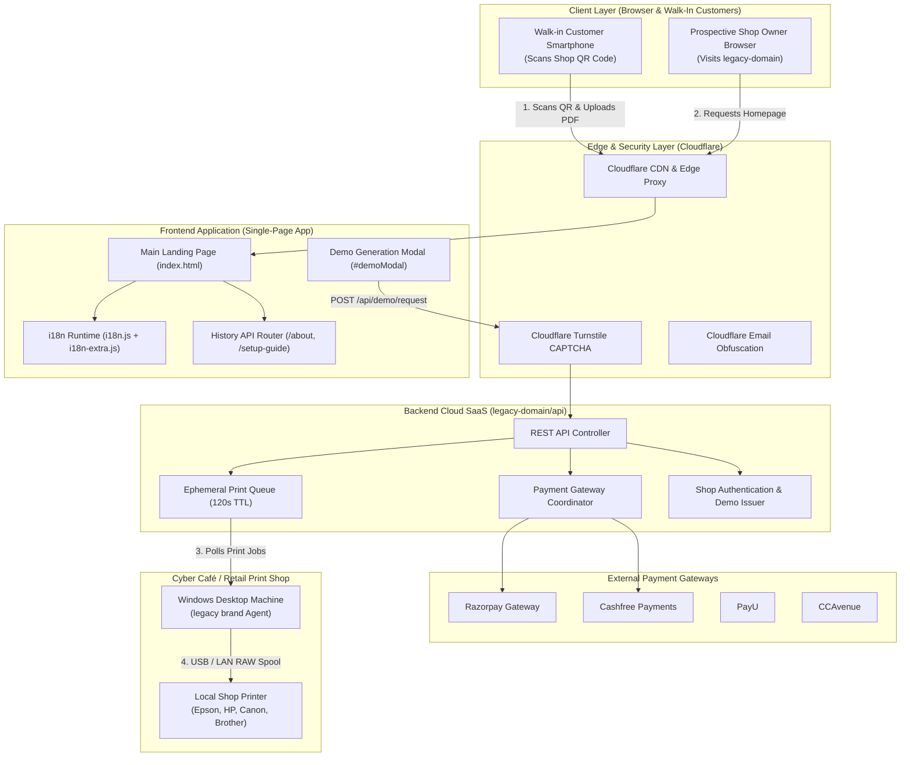
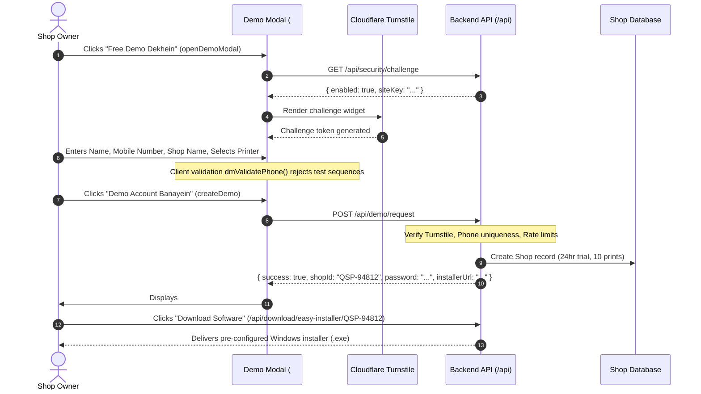
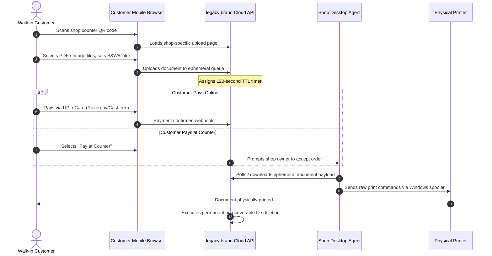
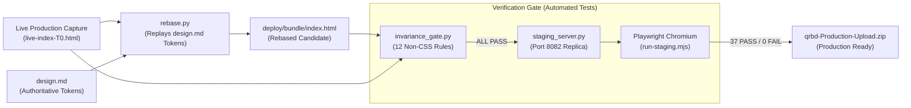

# Project Audit: Architecture Diagrams & Execution Workflows

This document visualizes the complete architectural landscape, startup execution flows, customer journey sequences, translation lifecycles, and verification pipelines across the legacy brand platform.

---

## 1. High-Level System Architecture



---

## 2. Client Application Startup & Hydration Flow

```mermaid
sequenceDiagram
    autonumber
    actor User as User Browser
    participant Canary as Canary Script (Script 0)
    participant DOM as Document Object Model
    participant I18n as i18n Engine (i18n.js)
    participant API as Backend API (/api/*)

    User->>Canary: Loads initial HTML head
    Note over Canary: Check location.hostname against allowlist
    alt Hostname Unauthorized
        Canary-->>User: document.open() -> Render warning -> Redirect to legacy-domain
    else Hostname Authorized
        Canary->>DOM: Allow HTML parser to continue
    end

    DOM->>I18n: Load i18n.js & i18n-extra.js
    I18n->>I18n: Read localStorage.getItem('qsp_lang') || 'en'
    I18n->>DOM: MutationObserver initiates; translates DOM to English
    
    par Asynchronous API Data Hydration
        DOM->>API: GET /api/homepage-config
        API-->>DOM: Support info, logo, feature lists
        DOM->>API: GET /api/setup-fee/current
        API-->>DOM: Current prices, festival discounts (work-67)
        DOM->>API: GET /api/reviews
        API-->>DOM: 11 Testimonial cards
        DOM->>API: GET /api/printer-models
        API-->>DOM: Printer dropdown options
    end

    DOM->>User: Interactive, fully translated paint complete
```

---

## 3. Demo Generation & Desktop Installer Provisioning Workflow



---

## 4. Walk-In Customer Contactless Print Workflow



---

## 5. Deployment & Invariance Toolchain



