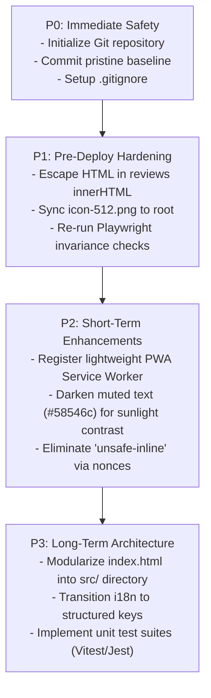

# Project Audit: Issues, Technical Debt & Prioritized Roadmap

This document outlines all technical defects, security risks, architectural bottlenecks, and maintenance challenges identified during the codebase audit, accompanied by a prioritized remediation roadmap.

---

## 1. Prioritized Findings Matrix

| Finding ID | Title / Issue Description | Category | Severity | Priority | Affected Location |
|---|---|---|---|---|---|
| **ISSUE-01** | Absence of Git Version Control in Workspace Root | DevOps / Risk | **Critical** | **P0 (Immediate)** | Workspace Root (`/`) |
| **ISSUE-02** | Stored XSS Vulnerability via Unescaped API Review Data | Security | **High** | **P1 (Pre-Deploy)** | [index.html#L6756](file:///c:/Users/livem/Downloads/Compressed/QRBD/index.html#L6756) |
| **ISSUE-03** | Missing PWA Companion Assets in Root Directory | Assets / PWA | **Medium** | **P1 (Pre-Deploy)** | Root Directory (`icon-512.png`, `og-image.png`) |
| **ISSUE-04** | Permissive CSP Directive (`script-src 'unsafe-inline'`) | Security | **Medium** | **P2 (Short-Term)** | [staging_server.py#L14](file:///c:/Users/livem/Downloads/Compressed/QRBD/deploy/staging_server.py#L14) |
| **ISSUE-05** | Missing PWA Service Worker Registration | PWA / Offline | **Medium** | **P2 (Short-Term)** | [site.webmanifest](file:///c:/Users/livem/Downloads/Compressed/QRBD/site.webmanifest) |
| **ISSUE-06** | Monolithic Single-File DOM Architecture (7,265 Lines) | Maintainability | **Medium** | **P2 (Short-Term)** | [index.html](file:///c:/Users/livem/Downloads/Compressed/QRBD/index.html) |
| **ISSUE-07** | Tight Coupling of i18n Dictionary Keys to DOM Text Nodes | Architecture | **Low** | **P3 (Long-Term)** | [i18n.js](file:///c:/Users/livem/Downloads/Compressed/QRBD/i18n.js), [i18n-extra.js](file:///c:/Users/livem/Downloads/Compressed/QRBD/i18n-extra.js) |
| **ISSUE-08** | Absence of Automated Unit Test Coverage for Logic Functions | Testing | **Low** | **P3 (Long-Term)** | `dmValidatePhone()`, `inr()` formatter |

---

## 2. Detailed Technical Findings & Remediation Plans

### ISSUE-01: Absence of Git Version Control in Workspace Root
- **Severity:** **Critical (P0)**
- **Impact:**
  The workspace has no initialized `.git` repository. Version tracking currently relies entirely on manual directory cloning (`_backup/`) and timestamped rollback files (`deploy/rollback/live-index-T0.html`). This creates severe risks of accidental file overwrites, unrecorded production drift, and inability to trace author commits or automated branch diffs.
- **Recommended Remediation:**
  1. Initialize local version control immediately:
     ```powershell
     git init
     git add -A
     git commit -m "chore: initial baseline commit of pre-redesign workspace"
     ```
  2. Create a standard `.gitignore` excluding temporary scratch scripts, OS artifacts (`.DS_Store`, `Thumbs.db`), and Playwright test output screenshots (`verification/shots/`).

---

### ISSUE-02: Stored XSS Vulnerability via Unescaped API Review Data
- **Severity:** **High (P1)**
- **Affected File:** [index.html#L6756-L6765](file:///c:/Users/livem/Downloads/Compressed/QRBD/index.html#L6756)
- **Impact:**
  Data returned from `/api/reviews` is directly interpolated into HTML strings and injected via `g.innerHTML = ...`. If an attacker submits a review with an XSS payload via an admin panel or public API endpoint that lacks strict sanitization, the script will execute in all visitors' browsers.
- **Recommended Remediation:**
  Introduce an HTML escaping helper function:
  ```javascript
  function esc(s) {
    return String(s || '').replace(/&/g,'&amp;').replace(/</g,'&lt;').replace(/>/g,'&gt;').replace(/"/g,'&quot;').replace(/'/g,'&#39;');
  }
  ```
  Apply `esc(v.name)`, `esc(v.text)`, and `esc(v.city)` when constructing the card template string.

---

### ISSUE-03: Missing PWA Companion Assets in Root Directory
- **Severity:** **Medium (P1)**
- **Affected Location:** Project Root (`/icon-512.png`, `/og-image.png`)
- **Impact:**
  While [site.webmanifest](file:///c:/Users/livem/Downloads/Compressed/QRBD/site.webmanifest) and OpenGraph `<meta>` tags reference `/icon-512.png` and `/og-image.png`, these files exist only inside `deploy/bundle/` and `qrbd-Production-Upload/`. Testing or serving from the repository root results in 404 HTTP errors.
- **Recommended Remediation:**
  Copy `deploy/bundle/icon-512.png` and `deploy/bundle/og-image.png` into the project root directory alongside `icon-192.png`.

---

### ISSUE-04: Permissive Content Security Policy Directive (`'unsafe-inline'`)
- **Severity:** **Medium (P2)**
- **Affected File:** [deploy/staging_server.py#L14-L23](file:///c:/Users/livem/Downloads/Compressed/QRBD/deploy/staging_server.py#L14)
- **Impact:**
  Allowing `'unsafe-inline'` for `script-src` and `style-src` bypasses CSP's primary defense against injection attacks.
- **Recommended Remediation:**
  Transition inline `<script>` tags into static, external JavaScript files (e.g. `main.js`, `router.js`, `pricing.js`). Calculate cryptographic SHA-256 hashes or deploy server-generated nonces for remaining inline scripts.

---

### ISSUE-05: Missing PWA Service Worker Registration
- **Severity:** **Medium (P2)**
- **Affected File:** [site.webmanifest](file:///c:/Users/livem/Downloads/Compressed/QRBD/site.webmanifest)
- **Impact:**
  Although the webmanifest declares `display: standalone`, modern mobile browsers (Chrome, Edge) require a registered Service Worker with an active `fetch` event handler to qualify for native install banners. Additionally, offline caching is absent.
- **Recommended Remediation:**
  Add a lightweight `sw.js` caching static brand assets, i18n dictionaries, and webfonts with a network-first caching strategy, registered in `<head>`.

---

### ISSUE-06: Monolithic Single-File DOM Architecture (7,265 Lines)
- **Severity:** **Medium (P2)**
- **Affected File:** [index.html](file:///c:/Users/livem/Downloads/Compressed/QRBD/index.html)
- **Impact:**
  Bundling 2,200 lines of CSS, 1,500 lines of HTML markup, and 3,000 lines of JavaScript in one file creates high cognitive load and requires complex custom Python rebase scripts ([rebase.py](file:///c:/Users/livem/Downloads/Compressed/QRBD/deploy/reference/rebase.py)) to merge upstream design changes.
- **Recommended Remediation:**
  Adopt a modular development directory structure:
  - `src/styles/` (`tokens.css`, `layout.css`, `components.css`)
  - `src/scripts/` (`router.js`, `demo-modal.js`, `reviews.js`, `pricing.js`)
  - `src/components/` (HTML templates)
  - Retain a simple post-build concatenation script that outputs the single deployable `index.html` for production hosting compatibility.

---

### ISSUE-07: Tight Coupling of i18n Dictionary Keys to DOM Text Nodes
- **Severity:** **Low (P3)**
- **Affected Files:** [i18n.js](file:///c:/Users/livem/Downloads/Compressed/QRBD/i18n.js), [i18n-extra.js](file:///c:/Users/livem/Downloads/Compressed/QRBD/i18n-extra.js)
- **Impact:**
  Translation keys are exact Hinglish source strings (e.g. `"Customer ke phone se"`). If copywriters tweak marketing headlines (e.g. changing `"Customer"` to `"Grahak"`), the translation lookup fails silently and English fallback text is not rendered.
- **Recommended Remediation:**
  Gradually introduce structured `data-i18n="hero.subheadline"` attributes to decouple translation identifiers from visible marketing prose.

---

## 3. Prioritized Strategic Roadmap



